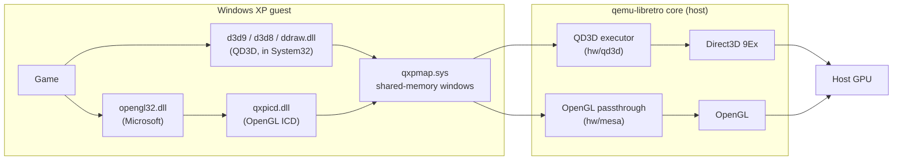

# XPDriver

3D acceleration for Windows XP guests of the
[qemu-libretro](https://github.com/webhead2oo9/qemu-libretro) core in
RetroArch. Direct3D 1–9, DirectDraw and OpenGL programs inside XP run on the
host's graphics card, system-wide: no per-game wrapper DLLs, nothing copied
into game folders, no patched games.

**Status:** 0.9 is the first public release. Direct3D 7–9 and OpenGL games
run end to end, but coverage is not yet broad: expect some games to render
incorrectly or fail. Reports with the guest's `qd3d.log` help.

## How it works

- **Direct3D 8/9, DirectDraw and Direct3D 1–7 (QD3D).** XPDriver's
  `d3d9.dll` serializes every Direct3D 9 call into a ring in shared memory;
  `d3d8.dll` and `ddraw.dll` translate Direct3D 8 and DirectDraw/Direct3D 1–7
  onto it. The core's executor replays the stream on Direct3D 9Ex on the
  host. The three DLLs replace Microsoft's in System32; the originals stay
  beside them as the fallback and for uninstalling.
  Design: [D3D9 remoting](docs/design/d3d9-remoting.md),
  [DirectDraw remoting](docs/design/ddraw-remoting.md).
- **OpenGL.** Microsoft's `opengl32.dll` loads `qxpicd.dll` through XP's
  standard driver (ICD) mechanism; it forwards to the core's OpenGL
  passthrough. Design: [ICD](docs/icd-design.md),
  [wire protocol](docs/mesa-qxpicd-protocol.md).
- **Display driver.** An XP (XPDM) miniport and display driver pair,
  `qxpmp.sys` and `qxpdisp.dll`, gives the desktop its display modes; its
  signed package also installs and registers the OpenGL driver.
  `qxpmap.sys` maps the core's shared-memory windows into guest processes
  ([design](docs/design/qxpmap.md)).

## Getting started

Download a release (`XPDriver-<version>.zip`) from the
[releases page](https://github.com/webhead2oo9/QEMUXPDriver/releases) and follow its `README.txt`
([the same text](packaging/README.txt)). In short: Windows 10/11 x64 with
the Windows Hypervisor Platform, RetroArch x64 and your own Windows XP SP3
CD image; install XP inside RetroArch with the bundled core, then run
`SETUP.CMD` from the XPDriver CD inside XP.

## Building

[BUILDING.md](BUILDING.md): Windows with the XP WDK for the drivers, WSL
with mingw-w64 for everything else, and `tools\make-release.ps1` for release
bundles.

## Repository layout

| Path | Contents |
|---|---|
| `qd3d/` | QD3D: the `d3d9.dll` proxy (`guest/`), the `d3d8.dll` and `ddraw.dll` front ends, the host executor (`host/`) and wire protocol (`proto/`) that the core carries, the system-wide installer (`install/`), the tools CD (`cd/`) and tests |
| `guest/xpdm/` | XP display miniport and driver, co-installer, package staging and signing |
| `guest/qxpmap/` | `qxpmap.sys`, the shared-memory window driver |
| `guest/qxpicd/` | The OpenGL ICD |
| `guest/acceptance/` | In-guest probes and the package installer (`qxpsetup.exe`) |
| `qemu/harness/` | The VM acceptance harness |
| `packaging/` | Release README and example RetroArch content files |
| `tools/` | Version, signing, release and XP slipstream tools |
| `core/` | The paired qemu-libretro core (submodule) |
| `docs/` | Design and protocol documents |

The host side lives in the qemu-libretro fork
[webhead2oo9/qemu-libretro](https://github.com/webhead2oo9/qemu-libretro),
branch `d3d9-remoting`, pinned as the `core/` submodule: the QD3D executor in
`hw/qd3d`, copied from this repository's `qd3d/host` and `qd3d/proto` by its
`scripts/qd3d-sync.sh`, and the OpenGL passthrough in `hw/mesa`. Every
release's `MANIFEST.txt` records both commits.

## Licence

GPL-2.0-only ([LICENSE](LICENSE)); bundled third-party components are listed
in [THIRD_PARTY_NOTICES.md](THIRD_PARTY_NOTICES.md). XPDriver is not
affiliated with Microsoft; you need your own licensed copy of Windows XP.
