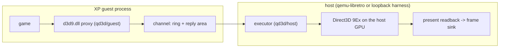

# Direct3D 8/9 remoting (QD3D)

Status: active design, 2026-11-01. Supersedes the in-guest Direct3D DDI
translation in `guest/xpdm/qxpdisp` (DP2 parsing, fixed-function emulation,
shader-to-GLSL lowering) as the route to Direct3D acceleration. The OpenGL
ICD (`guest/qxpicd`) is unchanged.

## Why

The in-guest DDI path re-implemented Direct3D inside a kernel-mode display
driver and lowered it to OpenGL. Measured on the project's own records:

| Path | Scene | FPS |
|---|---|---:|
| OpenGL ICD (thin forwarder) | Quake II `demo1` | 55.1 |
| OpenGL ICD (thin forwarder) | Warcraft III `-opengl` menu | 42.5 |
| D3D DDI (guest translation) | Warcraft III D3D8, r269 median | 9.7 |
| D3D DDI (guest translation) | Prince of Persia 3D phase | 1.2 |

Prince of Persia spent ~94% of wall time in the driver's DP2 handling with
WHPX live. Compatibility advanced one opcode or shader form per title, and the
ordinary qualified profile never left VS1.1/PS1.3. The design lesson is the
OpenGL one: keep the guest thin and let the host's GPU driver do the work.

## Decisions

- Direct3D 8 and 9 are remoted at the API level. Replacement `d3d9.dll`
  (and later `d3d8.dll`) in System32 serialise every call to the host, which
  executes it on native Direct3D 9Ex. The stock DLLs stay on disk for
  fallback. Games need no per-folder files. (User decision, 2026-11-01.)
- D3D8 converts to D3D9 inside the guest, at the bytecode level, without
  `d3dx9_43.dll` (not redistributable). DirectDraw / D3D1-7 come after
  D3D8/9.
- Everything shipped must be freely redistributable. The project is GPLv2
  (`LICENSE`): the ICD derives from GPLv2 qemu-3dfx and the host is QEMU.
  Borrowed permissive code keeps its notice (`THIRD_PARTY_NOTICES.md`).
- The host is Windows with native Direct3D 9Ex. A DXVK backend for other
  hosts is possible later behind the same executor interface.

## Architecture

| Path | Role |
|---|---|
| `qd3d/proto/qd3d_proto.h` | Wire contract: channel, framing, encoding, extension ops. Source of truth. |
| `qd3d/proto/qd3d_sizes.h` | Size/validation helpers shared by both sides. |
| `qd3d/gen/qd3d_gen.py` | Generator from apitrace's D3D9 spec. |
| `qd3d/proto/qd3d_ops.h`, `qd3d/guest/qd3d9_gen.*`, `qd3d/host/qd3dx_gen.*` | Generated, checked in. |
| `qd3d/guest/` | Proxy DLL runtime and hand-written methods (i686 MinGW, XP). |
| `qd3d/host/` | Executor core and overrides (x86_64 MinGW), loopback harness. |
| `qd3d/third_party/apitrace/` | Vendored apitrace specs (MIT). |

## Wire protocol

`qd3d_proto.h` is normative; this section only orients.

- One channel per guest process (a claimed slot, see Transports): control
  page, 16 MiB command ring, 4 MiB reply area. Commands are 16-byte
  aligned; at most one synchronous command is outstanding. ABI version 4
  adds the qxpmap kernel slot lifecycle and `REG_RELEASE` (version 3 added
  `CURSOR_POS`, `SOURCE_SHOWN`, `PRESENT.hidden` and the guest heartbeat;
  version 2 added the screen rectangle and cursor position to `PRESENT`,
  `CURSOR` and `CREATE_SWAPCHAIN`). Guest DLLs and the executor must come
  from the same build; incompatible channel ABIs are refused before
  submission, and a mismatched `HELLO` sends the guest to the stock runtime.
- Methods are classified once, in the generator:
  - generic (134): encoded by generated code on both sides; 75 synchronous
    (outputs, non-HRESULT returns, `Check*` answers), 59 asynchronous
    (state and draws return `D3D_OK` immediately);
  - guest-local (63): answered by the proxy (reference counting, private
    data, locks, display modes, descriptions, cursor);
  - extension (6): `CreateDevice`, `Reset`, both `Present`s,
    `Query::GetData`, `CreateAdditionalSwapChain`; `CURSOR` carries the
    cursor image the guest shows, `CURSOR_POS` and `SOURCE_SHOWN` what
    changes between presents (below).
- Objects are named by ids: guest ids for objects the guest creates,
  host ids (`0x80000000 | n`) for objects the host returns first (back
  buffers, surface levels). Each live id holds one host reference.
- Lock contents travel as `UPLOAD` after `Unlock`; GPU-written resources are
  read with `READBACK` on the next lock.
- The guest bounds `frames_submitted - frames_done` so it cannot run more
  than two frames ahead.

## Guest proxy

- Every interface pointer is a `struct qd3d_obj` (vtable first).
- Object lifetime follows the native runtime, measured against the stock
  32-bit `d3d9.dll`: binding does not change an object's public count; an
  object the application releases while bound (texture, stream, index
  buffer, declaration, shaders, render target, depth stencil) stays alive
  and `Get*` returns that same object; such an object gives up its device
  reference at once; level surfaces live as long as their texture; the
  device owns its implicit swap chain, back buffers and automatic depth
  stencil until `Reset` or its end; releasing the device drops everything it
  keeps alive. Each proxy therefore has public `refs` and internal `holds`
  (device slots, state blocks by `D3DSTATEBLOCKTYPE`, containers, the
  device) and is destroyed when both are zero. Need for Speed: Underground 2
  relies on this: it releases bound objects twice when its video options
  change.
- Without `D3DCREATE_FPU_PRESERVE`, `CreateDevice` masks every x87 exception
  and selects single precision, round-to-nearest in the calling thread, as
  the native runtime does (Need for Speed: Underground 2 runs with invalid
  operation unmasked and traps on its first NaN otherwise).
- One session (`HELLO`) per process; every `Direct3DCreate9` returns a new
  `IDirect3D9` (native) that answers `IID_QD3D_REMOTE`
  ({5f3e1c2a-8b47-4d16-9e03-7a51c26b8814}, `qd3d_proto.h`) while connected;
  the session's root object is released at `GOODBYE`.
- Textures live in one contiguous guest block with the native mip/cube
  layout and pitch (measured on stock 32-bit d3d9: pitch rounded up to 4,
  levels back to back, cube faces 32-byte aligned), so applications that
  write every level through the level-0 pointer work (Wine cites
  Vivisector and Cryostasis). Levels and faces share their container's
  reference count. Managed resources upload at first use (draw,
  `ProcessVertices`, `PreLoad`) like native, system-memory textures with
  `D3DLOCK_NO_DIRTY_UPDATE`; buffers drawn from while still mapped upload
  their writes at draw time. Resources the GPU wrote are read back on the
  next lock. ATI1N/ATI2N and YV12/NV12 locks use the pool-dependent native
  geometry (`qd3d_proto.h`).
- The native runtime's pre-submission checks run in the guest from guest
  metadata, so asynchronous calls still fail where native fails: scene
  nesting, draws without a declaration, `Clear` without depth, stream
  frequency, state block `Apply`/`Capture` while recording,
  `SetRenderTarget`/`SetDepthStencilSurface` rules, the copy rules of
  `StretchRect`/`ColorFill`/`UpdateSurface`/`UpdateTexture`/
  `GetRenderTargetData`, lockability, creation rules, shader-constant
  ranges. Generated wrappers leave out-parameters untouched on failure,
  except where native clears them.
- Display modes and the adapter mode list come from the guest's own GDI, so
  fullscreen mode changes happen in the guest and input coordinates match.
- The device cursor is a Windows cursor, as with the native runtime
  (measured on the stock 32-bit runtime, Windows 11, windowed; Wine's
  `test_cursor`/`test_cursor_pos` agree): `ShowCursor` shows nothing until
  `SetCursorProperties` gave a bitmap (power-of-two sizes no larger than
  the display mode, hot spot inside, `A8R8G8B8`, read from the guest
  surface; a non-lockable render target through `GetRenderTargetData`);
  `ShowCursor(TRUE)` makes it the Windows cursor at once (`SetCursor` of a
  cursor built with `CreateIconIndirect`: alpha 255 opaque, every other
  pixel transparent, as natively) and `ShowCursor(FALSE)` leaves none;
  `SetCursorPosition` moves the Windows cursor (`SetCursorPos`) unless it
  is there already, and not before a bitmap was given. So it follows the
  guest's mouse like the Windows cursor it is. The bitmap keeps its size
  (Windows 11's runtime scales it to the system cursor size, Wine does not;
  32x32 is that size anyway).
- Cursor over QD3D frames: the VM shows Direct3D frames instead of the
  guest desktop, where GDI draws the pointer into the framebuffer (the
  XPDM display driver has no hardware pointer and the libretro frontend
  draws none). Every `Present` therefore reads the cursor the guest shows
  (`GetCursorInfo`: the Windows cursor, which the device cursor is) and
  where its window puts the image on the guest screen (windowed: the
  destination rectangle in the client area, mapped to the screen;
  fullscreen: the display mode); a new cursor handle sends its image once
  (`CURSOR`; `GetIconInfo`/`GetDIBits`: monochrome AND/XOR pairs become
  opaque, transparent or inverting pixels, 32-bit cursors keep their
  alpha). The executor draws it over the published frame, in the same
  place and shape GDI draws it on the 2D desktop.
- Between presents the cursor follows the mouse, as a hardware cursor plane
  does natively (strategy, adventure and turn-based games redraw their
  screens only when something changes; Age of Empires II's menus present 3
  to 8 times a second). From a device's first present until the last
  device that presented is released, a poller thread of the proxy wakes
  every 8 ms (no finer than the system timer: 15.6 ms on Windows XP unless
  the application raised it with `timeBeginPeriod`, as games commonly do;
  above normal priority, so a busy application does not delay it) and
  compares the cursor (`GetCursorInfo`) and the windows of the frame
  sources that presented with what the last `PRESENT` or its own last
  report said: a moved, shown, hidden or changed cursor goes out as
  `CURSOR_POS` (a new image first as `CURSOR`). It never waits for the
  connection lock (a busy lock moves a report to the next tick) and takes
  it only to report. It also advances the control page's `heartbeat`
  (below). There is no thread before the first present. The thread holds
  a reference on the DLL (`FreeLibraryAndExitThread`) and the release of
  the last device that presented ends it and waits for it (normally
  microseconds; at most 100 ms, as a thread ending needs the loader lock a
  release inside a `DllMain` holds), so `FreeLibrary` after the last
  `Release` unloads the proxy at once, as natively (`qd3d9_multiproc`
  `unload`). Measured (loopback, Windows 11, `qd3d9_smoke`
  `cursor_follow`): the process's other threads used 0.000% of a core
  before the first present, the poller 0.10% to 0.17% with a still mouse
  and 0.14% to 0.21% with the mouse moved every 10 ms. Direct3D 8 and the
  DirectDraw front end present through the proxy, so they get the same
  poller (the front end's exclusive mode included: `qd3d_ddraw_cursor`).
- Minimized and hidden windows: a frame source (a device's implicit swap
  chain, or an additional swap chain) whose presentation window is
  minimized, or hidden after it showed, shows nothing natively; the
  desktop does. `PRESENT` says so (`hidden`) and the poller reports a
  change between presents (`SOURCE_SHOWN`); a window that never showed (a
  front end's helper window) never hides frames.
- Additional swap chains (`CREATE_SWAPCHAIN`) follow the native rules
  (Wine's `test_swapchain` on the stock runtime): none in fullscreen or on
  a fullscreen device; a missing window is the focus window
  (`GetPresentParameters` reports it, the caller's structure keeps `NULL`),
  a zero size the window's client area, a zero count one, written back as
  for `CreateDevice` (Direct3D 8 writes back the count only); the swap
  chain holds a device reference and owns its back buffers (their own
  counts, its container, gone with it unless the application holds them);
  a failed `GetBackBuffer` leaves the pointer alone; `GetSwapChain` and
  `GetNumberOfSwapChains` know only the implicit swap chain.
- No channel (other emulator, host without the device, every slot busy):
  forward `Direct3DCreate9` and `Direct3DShaderValidatorCreate9` to the
  stock runtime; `%TEMP%\qd3d.log` records why (Transports). The stock
  runtime is `System32\qd3d9_orig.dll` when installed, and for a per-game
  copy too once a system-wide install keeps the stock DLL there (System32's
  `d3d9.dll` is then another proxy); else `System32\d3d9.dll`. A QD3D copy
  is never taken as the stock runtime: a second proxy in one process would
  claim a second channel slot (`make -C qd3d/tests run-one-proxy`).

## Host executor

- Validates every id, type, length and count before native Direct3D sees
  it. A violation faults the session (`QD3D_HOST_FAULT`); it never guesses.
  Every upload and readback copy is bounded by the native lock in the
  pool's layout (`qd3dx_plan`). Guest-controlled indices on which the
  retail 9Ex runtime crashes, hangs or corrupts its heap (lights, palettes,
  texture stages, samplers, streams, render-target index,
  `DrawIndexedPrimitiveUP` indices, copied out of shared memory before the
  check) are range-checked in host overrides. Host ids are unique for the
  executor's lifetime. `qd3dx_selftest --heap-check` runs the self-test
  under the system debug heap.
- Direct3D 9Ex has no managed pool: managed resources become default-pool
  resources plus a system-memory staging copy for uploads. Textures in
  system memory are sampled through a default-pool copy (this driver does
  not sample system memory). `GetAvailableTextureMem` counts the executor's
  default-pool allocations against the 512 MiB clamp.
- Off-screen device on a hidden window (additional swap chains present to
  it too). `PRESENT` resolves the presented part of the back buffer (its
  source rectangle, else all of it; through `StretchRect` for MSAA and
  16-bit formats) into a non-multisampled render target and queues
  `GetRenderTargetData` into one of three system-memory copies per device,
  runs the native Present, then hands the previous frame's BGRA rows to
  the frame sink (the libretro frame publication in qemu-libretro, a
  window in the loopback harness): frames reach the sink in present
  order, at most one frame behind, and the last one when the embedder
  goes idle (`qd3dx_prepare_wait`), before Reset, `GetFrontBufferData`,
  device release and `GOODBYE`. `frames_done` counts frames that reached
  the sink (or were not shown, below), so the guest's two-frame limit
  still bounds present-to-display latency. Measured on this driver (RTX
  4090, Windows 11, 9Ex): `GetRenderTargetData` returns at once and copies
  in the background, an event query completes only after a blocking
  flush, and `LockRect` ignores `D3DLOCK_DONOTWAIT` on system-memory
  surfaces, so the executor simply locks the copy one frame later.
- Which swap chain is shown: the VM shows one frame at a time, so of a
  device's swap chains the largest that presents is shown. A swap chain's
  frame is published unless another swap chain of the device with frames
  at least as large is shown and presented within the last 250 ms; the
  shown one keeps a tie, and one that stopped presenting yields after
  that hold. A frame not shown is not read back. So a game that renders
  through an additional swap chain only is shown, and a small preview
  window beside a large main view does not flicker over it. (Frames of
  different devices and slots all reach the sink, as before.)
- The cursor (`CURSOR` image, `PRESENT` position) is drawn over the frame
  as it is published, at the frame pixel its guest screen position maps
  to, then taken out of the copy again: the frame sink sees it, the back
  buffer and `GetFrontBufferData` never contain it, like a hardware
  cursor. A `CURSOR_POS` while the frame is in flight moves its cursor;
  otherwise the last published frame goes to the sink again from its
  system-memory copy (never read back again) with the cursor at the new
  place (`qd3dx_frame.repeat` = `QD3DX_REPEAT_CURSOR`): at most once per
  8 ms after the last publication, a faster burst ending with its last
  state (the embedder's idle round publishes a pending update), nothing
  when the cursor neither was nor is over the frame; `frames_done` does not
  count repeats, and a `PRESENT` supersedes a pending update.
- Hidden source: a hidden `PRESENT` is executed natively but not read back
  or published (`frames_done` counts it). When the source of the last
  published frame hides (hidden `PRESENT` or `SOURCE_SHOWN` 0), the frames
  presented before are published, then the embedder hears it
  (`qd3dx_hooks.source_hidden`) and nothing of that source is published
  (no cursor repeats) until its window shows: `SOURCE_SHOWN` 1 publishes
  its last frame again (`QD3DX_REPEAT_SHOWN`), a visible `PRESENT` a new
  one. Other sources' windows say nothing.
- Display policy (`qd3dx_display_*` in `qd3dx.h`, shared by the VM device
  and the loopback harness): presented frames and frames shown again of
  any slot show; cursor repeats only of the slot shown. The desktop comes
  back at once when the source of the frames shown is released or hidden,
  and once the slot shown gave no sign of life for 3 s
  (`QD3DX_DISPLAY_IDLE_US`): no command executed and no `heartbeat`
  movement (`qd3dx_alive`). The poller beats the heartbeat on every tick
  while a device that presented lives, however static the screen, so only
  a fully stalled guest, or a loopback process that died without `GOODBYE`,
  falls back on that timeout (VM process cleanup releases immediately);
  when that slot lives again (a paused VM resumed) the embedder asks
  for its last frame (`qd3dx_show_again`).
- Released frame source: the executor remembers the source of the last
  frame it published (its device, and the additional swap chain it was
  presented through, if any). When that device or swap chain is released,
  by the guest or because its session ends (`GOODBYE`, the next `HELLO` on
  the slot, `qd3dx_reset`, kernel `REG_RELEASE`), the embedder hears that
  no more frames can come from it (`qd3dx_hooks.source_released`). An
  ordinary release or `GOODBYE` publishes the frame in flight first;
  `HELLO`, reset and kernel release instead drop the abandoned frame.
  Releasing anything else says nothing:
  a device whose frames are not the last published (its frame in flight
  is published, so "last" is current), a swap chain not shown, the
  implicit swap chain's own id (`Reset` releases it), `RESET` itself; the
  implicit swap chain ends only with its device. `qd3dx_destroy` calls no
  hook. The guest releases a device when the application's last reference
  goes (Direct3D 8 and the DirectDraw front end release their Direct3D 9
  device the same way, the latter when an application leaves exclusive
  mode without a 3D device).
- `GetFrontBufferData` (and Direct3D 8 `GetFrontBuffer`) returns what the
  guest's screen shows of the device: the last published frame at the
  guest screen rectangle it was presented to (scaled to it, nearest
  texel), opaque black elsewhere. Natively the front buffer of a windowed
  device is the desktop, with the window's image at its client area.
- Managed texture LOD: natively a managed texture with LOD *n* is given a
  video-memory copy that starts at level *n*, so every sampler reads level
  *n* as its most detailed level and `D3DSAMP_MAXMIPLEVEL` *m* limits it to
  max(*m*, *n*), even with `MIPFILTER NONE` (Wine's `maxmip_test` on the
  stock runtime). The host texture is a whole default-pool texture, so the
  executor keeps the LOD (`SetLOD` override, managed textures only) and
  around each draw gives every stage whose texture has one `MAXMIPLEVEL`
  max(*m*, *n*), and with `MIPFILTER NONE` (which the driver ignores
  `MAXMIPLEVEL` for) `POINT` mip filtering, `MAXMIPLEVEL` *n* and a -16 LOD
  bias; the guest's values come back after the draw, so getters and state
  blocks see them. Draws while a state block records are left alone.
- `HELLO` and `GOODBYE` bound a session; a new `HELLO` releases everything
  a crashed loopback predecessor left. VM handle cleanup instead sends
  `REG_RELEASE`, which ends the session without requiring another client.
- 9Ex `ResetEx` keeps every device state (measured); after `RESET` the
  executor restores the native D3D9 defaults (a `D3DSBT_ALL` state block
  captured on the pristine device, render targets 1-3 unbound, viewport and
  scissor on the new back buffer, lights off).
- Asynchronous methods answer `D3D_OK` at once. Methods whose result games
  act on are synchronous: the `Check*` family and `BeginStateBlock`, which
  fails while a recording is open (F.E.A.R. nests recordings and skips the
  inner one on that failure; answering `D3D_OK` scrambled its materials and
  it drew nothing).
- `ValidateDevice`: current drivers answer `E_FAIL` for every state, a fresh
  device's defaults included (measured: RTX 4090, Windows 11, Direct3D 9 and
  9Ex), and D3D8-era games abort on any failure (Max Payne: "Failed to
  validate material"). A definite native verdict is kept; otherwise the
  fixed-function stage cascade is checked against the device caps (stage
  count, `TextureOpCaps`, argument selectors, `RESULTARG`,
  `MaxSimultaneousTextures`). Filters are not refused: the host renders
  every filter, and refusing only pushes games onto worse fallbacks.
- `QD3DX_TRACE=1` in the host process environment logs, once a second, the
  executed commands by count, frames published with their PRESENT-to-sink
  delay and readback wait; the first three failures of each op with their
  leading argument words; and the 16 commands before the first failure of
  each op.

## Transports

Both transports offer channel slots: independent channels, each with its
own executor session, one Direct3D process per slot (`qd3d_proto.h`,
Transports). A launcher that keeps its `IDirect3D9` while the game runs
holds one slot and the game takes another: Prince of Persia: The Sands of
Time's `PrinceOfPersia.exe` runs its hardware detection through the proxy
(`HELLO`, no device) and starts `POP.EXE` while still alive.

- Ownership: in the VM, `qxpmap.sys` assigns one free slot per open
  `\\.\QXPMAP` handle. The proxy opens it with read/write sharing and no
  inheritable security attributes, queries the device, then claims a slot;
  the driver returns only that slot's channel and the register page. The
  handle stays open for the session. A thread's exit cannot release it,
  and multiple processes can connect without MapMem's exclusive-open
  conflict. `FreeLibrary` sends `GOODBYE`, issues `QD3D_RELEASE` and closes
  the handle. Process exit does no user-mode teardown: kernel cleanup
  unmaps both views, writes the slot index to `REG_RELEASE`, then makes the
  slot free. A process that finds every slot busy uses the stock runtime.
  User mode neither chooses physical addresses nor creates global slot
  claims.
- Loopback (development, no VM): the 64-bit harness owns the named mappings
  `NAME` (slot 0) and `NAME_<i>`, one doorbell event `NAME_KICK` for all
  slots and one executor per slot, all on one thread. `NAME` is
  `Local\QD3D_LOOPBACK` unless `qd3d_loopback --name NAME` and
  `QD3D_LOOPBACK_NAME=NAME` in the application's environment select
  another (`run-loopback.ps1` uses a fresh name per run so runs can
  overlap); `--slots N` (1-4, default 1, `run-loopback.ps1 -Slots N`) sets
  the slot count. A 32-bit Direct3D 9 application with the proxy beside it
  connects to it; this runs the complete guest/host path on the host GPU.
  Ownership here remains the non-inheritable event `NAME_SLOT_<i>`:
  `CreateEvent` must create it rather than open an existing claim. A
  session that ends without `GOODBYE` stays until the next `HELLO` on its
  slot; a faulted one is reset once its process is gone. The harness also
  exposes `NAME_RELEASE_<i>` to exercise the VM release path: stop the old
  producer, signal it and wait until the harness resets it before allowing
  the next claimant to connect.
- VM: the qemu-libretro device maps four slots of 32 MiB as RAM from
  guest-physical `0xd0000000` and a register page at `0xd8000000` (`KICK`
  at `0x000`, `ID` at `0x004`, `SLOTS` at `0x008`, write-only `RELEASE` at
  `0x00c`); guest RAM is 1 GB, the other fixed devices
  sit at `0xefffe000` (Mesa) and `0xfbdff000` (Glide), PCI BARs from
  `0xe0000000`. Its one thread runs an executor per slot, polls every slot
  each round, and sleeps only when no slot has work; any doorbell wakes it.
  A `RELEASE` write atomically records that slot's current producer cursor
  and wakes the executor; the vCPU thread never releases Direct3D objects.
  Before processing more packets, the executor drops the old session and
  any frame still in flight, skips its packets only up to the recorded
  cursor, and returns the desktop if that slot was shown. A new claimant
  appends its synchronous `HELLO` at the existing ring cursor, so release
  cannot discard its commands or resurrect stale ones. Idle and repeated
  releases are harmless; out-of-range indices are ignored and logged once.
  A faulted slot is reset after 1 s (a new owner waits up to 2 s for it);
  a system reset resets every slot. Frames of every slot go to the frontend
  as the display policy (Host executor) decides: the desktop returns as
  soon as the device or swap chain whose frames are shown is released
  (`source_released`; the frames it presented before have reached the
  frontend by then), as it reappears natively when a game releases its
  device to leave exclusive mode or return to a launcher that lives on,
  or as soon as its window is minimized or hidden (`source_hidden`), and
  after 3 s of silence from the slot shown (a fully stalled guest). Process
  exit now returns it immediately through the kernel release, without
  waiting for the heartbeat timeout. A presented frame from any
  slot brings 3D back. A static screen stays up for as long as its
  process lives: the proxy beats the slot's heartbeat. The cursor is in
  the frames the executor publishes (Host executor), including the
  repeats that move it between presents, so the device composes it; the
  frontend shows frames as they come. `QD3D_FPS=1` in the RetroArch
  environment reports every 2 s while 3D output is on, as
  `qd3d: 4.1 fps game, 118 display updates/s (cursor), 800x600`: the frames
  the game presented per second and, only when the cursor moved between
  presents in that window, how often the display changed (every frame
  shown, the cursor's re-publications included), then the size of the last
  frame shown; without cursor re-publications the line is
  `qd3d: 59.9 fps game, 800x600`, and a static screen reads `0.0 fps
  game`. (Cores built before 2026-11-02 16:28 print `qd3d: N fps (frames
  in s, WxH)`, presented frames only.)
- Mapping driver: `guest/qxpmap/` is XPDriver's source-built XP x86 kernel
  driver. `QD3D_CLAIM` maps only the chosen QD3D channel and register page;
  closing the handle or `QD3D_RELEASE` revokes the mappings. Neither QD3D nor
  the OpenGL ICD (`guest/qxpicd`, Mesa windows via `IOCTL_QXPMAP_MAP_WINDOW`)
  uses `fxptl.sys` or `\\.\MAPMEM` any more. The system-wide installer
  installs/updates `qxpmap.sys` under `%SystemRoot%\system32\drivers` and
  manages its `qxpmap` kernel service; the signed XPDM package carries it too.
  `qd3d_install.exe driver` changes only the mapping driver for per-game
  test installations; the CD's `UPDATE.CMD` always runs it (it is idempotent)
  before copying game DLLs, since XP's `sc.exe` exits 0 for a missing service.
- Field log: rare events go to `%TEMP%\qd3d.log` as well as the debug
  output (and stderr with `QD3D_LOG=stderr`): the connection result with
  transport and slot, or the failure reason with its error code (including
  `QD3D mapping driver not installed (\\.\QXPMAP error N)`,
  `all QD3D slots busy`, and `no QD3D device`); the first
  fallback to the stock runtime and why; channel death; the first 8
  `CreateDevice` and 8 `Reset` failures with their `HRESULT`. One line
  each, `YYYY-MM-DD hh:mm:ss pid exe: message`, appended (one write, so
  processes do not interleave); the file is emptied once it has grown past
  1 MiB. Nothing is logged per call or per frame.

## Direct3D 8

`qd3d/d3d8/` implements every Direct3D 8 interface on Direct3D 9 inside the
guest (C++ without exceptions, RTTI or libstdc++). It uses a QD3D `d3d9.dll`
the process already has (a game's own copy; a second proxy would claim a
second channel slot), else loads `d3d9.dll` from its own directory (System32
when installed, so the QD3D proxy), else the system copy. D3D8 vertex
shaders become a D3D9 vertex declaration plus `dcl` tokens inserted into the
vs.1.0/1.1 bytecode; vs.1.0 and ps.1.0 are promoted to 1.1; `D3DVSD_CONST`
constants are applied at `SetVertexShader`. Texture-stage states that moved
to sampler states in D3D9 are split on Set and Get; removed render states
are stored for Get.
Wrappers follow the native D3D8 lifetime, measured on the stock 32-bit
`d3d8.dll`: a public count plus internal holds; an object released while
bound keeps its identity without a device reference; levels share their
texture's count; the device owns its implicit surfaces; `D3DSBT_ALL` and
recorded state blocks hold their objects; `DrawPrimitiveUP` unbinds stream
0 and `DrawIndexedPrimitiveUP` also the indices; Reset and the device's
end drop bindings, state blocks and implicit surfaces first. `Get*`
answers come from the front end's own slots.

Validation, translation and return codes follow stock `d3d8.dll` (measured
with Wine's tests and probes): shader validation and its error strings,
caps bits, `CheckDeviceType`/`CheckDeviceMultiSampleType`, `Reset` and
device-lost codes, viewport and render-target rules, `CopyRects` from
multisampled surfaces. The adapter mode list is exactly D3D9's
X8R8G8B8, R5G6B5 and X1R5G5B5 lists in that order (Windows decides per
process whether 16-bit modes exist; both runtimes agree). Installed in
System32, the front end hands `Direct3DCreate8` to the stock
`qd3d8_orig.dll` when the `d3d9.dll` it loads gives no QD3D session (no
`IID_QD3D_REMOTE`); `QD3D8_TEST_SYSTEM_DIR` exercises this on a host.

## Verification

Build-time:

- `python3 qd3d/gen/qd3d_gen.py --check` keeps generated files current.
- Everything builds with `-Wall -Wextra -Werror`. The guest asserts every
  vtable slot of all 15 concrete interfaces against the SDK headers, and
  both sides assert the measured size of every type on the wire
  (`WIRE_LAYOUT`): `D3DADAPTER_IDENTIFIER9` is 1100 bytes on i686 and 1104
  on x64 (tail padding after a 4-aligned `LARGE_INTEGER`), so the wire
  carries the 1100-byte prefix.
- `check-imports` limits the guest DLLs to XP SP3 imports.

Permanent tests, all passing on the RTX 4090 host (2026-11-02, integrated
builds):

| Test | Covers | Result |
|---|---|---|
| `qd3d/guest/build/qd3d9_ringtest.exe` | ring framing, PAD/wrap, sync replies, upload chunking, readback, dead channel, children released before parents, the `qd3d.log` line a channel death leaves and the 1 MiB limit | pass |
| `qd3d/host/build/qd3dx_selftest.exe` (also `--heap-check`) | 24 fault classes plus malformed `CURSOR`/`CREATE_SWAPCHAIN`/`PRESENT` cursor flag, GPU path, uploads/readbacks in every pool layout (ATI1/ATI2/YUV included), MSAA, reset defaults, `ValidateDevice` from caps, session release with live surfaces, host ids across sessions, out-of-range arguments, pipelined present; cursor drawn over published frames (opaque, transparent, inverting, blended pixels, clipped, scaled screen rectangle, a frame keeping its image while the next arrives) and absent from `GetFrontBufferData`, which places the frame at its screen rectangle; additional swap chain render/present/back buffer, the display policy (smaller swap chain not shown while the larger presents, shown after the hold), source rectangles; managed LOD (max(`MAXMIPLEVEL`, LOD), `MIPFILTER NONE`, clamping, guest sampler states and state blocks kept, DEFAULT textures unaffected, survives Reset); `source_released` in order after the released source's frames (device with a frame in flight, additional swap chain, `GOODBYE`, next `HELLO`, `qd3dx_reset`) and never for another device, the implicit swap chain's id, `RESET` or `qd3dx_destroy`; cursor repeats between presents (exact pixels at the new position, `frames_done` unchanged, a 10-update burst giving 1 to 3 repeats ending at its last position, off the frame once then nothing, a new image, hidden, the frame in flight taking the newer position, a `PRESENT` superseding a pending update, nothing after the release, malformed `CURSOR_POS`); hidden windows (hidden `PRESENT` not published and counted, `source_hidden` once after the frame before, nothing while hidden, `SOURCE_SHOWN` 1 and `qd3dx_show_again` repeating the frame, a visible `PRESENT` after hiding, other devices silent, an additional swap chain answering for its own window, malformed `SOURCE_SHOWN`); `qd3dx_alive` (heartbeat, commands) and the display policy with synthetic times | 0 failures, 0 heap reports |
| `qd3d/tests/build/qd3d9_smoke.exe` via `qd3d/tests/run-loopback.ps1` | 19 Direct3D 9 scenes through proxy and executor, including the x87 state after `CreateDevice`, native binding lifetime, the device cursor and a monochrome Windows cursor over the run's first two published frames (pixels checked in the harness's frame dumps, `QD3D_FRAME_DUMPS`) and not in the front buffer, a second device's release reported after its two frames (the harness's `source_released.txt` and dumps), the cursor following the mouse between presents (one present, then the harness's repeats of that frame show the cursor at two more points, no further frame; the poller's CPU load), managed LOD, an additional swap chain, front buffer contents at the window's screen position | 19/19 (cursor checked in dumps 1 and 2, release after frame 5, cursor at 3 points over frame 7) |
| `qd3d/tests/build/qd3d9_display.exe` via `run-loopback.ps1 -Program <qd3d9_display.exe> -Slots 2` | the display policy end to end (the harness logs its transitions in `display.txt`): one present, then 6.5 s without presenting stays up; minimized and restored, hidden and shown: the desktop at once and the frame again at once without a present; a child that presents on slot 1 and terminates itself without `GOODBYE`: the desktop 3 s after its death | 9/9 checks (the desktop 3015 ms after the child's death) |
| `qd3d/tests/build/qd3d_ddraw_cursor.exe` via `run-loopback.ps1 -Program <qd3d_ddraw_cursor.exe> -WithDDraw` | the DirectDraw front end's exclusive mode (800x600x32 flip chain, virtual modes): one flip, then repeats of that frame show the window's cursor at two more points without a present; leaving exclusive mode releases the frame source | 6/6 checks |
| `qd3d/tests/build/qd3d9_multiproc.exe` via `qd3d/tests/run-multiproc.ps1` (two `run-loopback.ps1` runs, `-Slots 2` and `-Slots 1`) | several processes on channel slots: a launcher holding an `IDirect3D9` without a device while its child gets a slot of its own and renders, then both render at once; a child terminated while holding its slot and device, whose slot the next child reuses (the executor's `HELLO` releases the dead session's objects); with one slot, a second process gets the stock runtime and `qd3d.log` names the reason, and `FreeLibrary` of the proxy gives the slot back at once; exact pixel readback in every process | 4/4 scenarios |
| `qd3d/d3d8/build/qd3d8_smoke.exe` via `run-loopback.ps1 -Program <qd3d8_smoke.exe> -WithD3D8`, and `make -C qd3d/d3d8 run-stock run-wrapped run-fallback` | 17 Direct3D 8 scenes, including native binding lifetime, the adapter mode list and `GetFrontBuffer` contents (both halves of a presented frame at their screen positions) | 17/17 in all four |
| `make -C qd3d/install test` | installer against a redirected fake XP tree and fake SCM: driver-only mode, install/update, busy/reboot replacement, uninstall, service state/configuration and exact file rollback with failure injected at every step | 559 checks |

ABI 4 integration additionally exercises idle, shown/nonshown mid-frame,
double, coalesced and in-command slot release; stale queued packets are
discarded and a successor's `HELLO` survives the captured release boundary.
The executor self-test passed 4943 checks normally and 1271 under
`--heap-check`, with zero failures or heap reports (the polling checks are
timing-dependent). The ABI 4 loopback suites passed DirectDraw 11/11,
Direct3D 7 22/22 and legacy Direct3D 21/21 scenes; the four XP SP3 import
gates accepted 91 (`d3d9.dll`), 46 (`d3d8.dll`), 103 (`ddraw.dll`) and 56
(`qd3d_install.exe`) imports. Logs and frame evidence:
`artifacts/runs/qxpmap-abi4-a61599a1/`. The first cursor run observed mouse
movement and skipped its pixel checks; an uninterrupted rerun passed all
six checks.

Both smoke tests also pass against the stock runtimes (the D3D9 smoke 17/17
with the same cursor, LOD, swap chain and front buffer expectations;
frame dumps exist only through the loopback harness).

Conformance: `qd3d/conformance/` builds Wine's Direct3D 8/9 API tests
(`wine-11.0`, vendored in `qd3d/third_party/wine/`, fullscreen, mode,
cursor and focus tests excluded) and `run.ps1` runs each against the stock
runtime, through QD3D (proxy, front end, own loopback executor), and for
Direct3D 8 with the front end on stock Direct3D 9. A finding is a failure
that appears only through QD3D. Failures per test, stock in parentheses:

| Test | First run (2026-11-02 01:19) | Integrated (2026-11-02 03:09) | Before gaps round (12:40, 12:48*) | After gaps round (13:15) |
|---|---:|---:|---:|---:|
| d3d9 device | 2397, 4 crashes/hangs incl. an executor heap corruption | 6 (1) | 11 (1), crash in `test_swapchain`* | 6 (1) |
| d3d8 device | 2496, 5 crashes | 6 (0) | 10 (0), crash in `test_swapchain`*; front end on stock d3d9 12 | 6 (0); front end on stock d3d9 5 |
| d3d9 visual | 187, 2 crashes | 73 (69) | 73 (69) | 70 (69) |
| d3d8 visual | 81, 1 crash | 3 (2) | 3 (2) | 3 (2) |
| d3d9 stateblock | 16 | 2 (0) | 2 (0) | 0 (0) |
| d3d8 stateblock | 17 | 2 (0) | 2 (0) | 0 (0) |

\* `test_swapchain` runs again since 2026-11-02 12:45 (only its fullscreen
reset is excluded); the device rows of the "before" column come from that
build. Run directories: `%TEMP%\qd3d-conf-gaps-before`,
`qd3d-conf-gaps-before-swapchain`, `qd3d-conf-gaps-after1`. With the
released-source hand-back (14:09, `qd3d-conf-handback`) and with the
cursor between presents, hidden windows and the heartbeat (16:01 and
16:11, `qd3d-conf-cursor`, `qd3d-conf-cursor2`) every count is the same
as in the last column.

The latest run has no crash, hang or executor fault in any QD3D mode
(stock `d3d8.dll` itself crashes in `test_resource_access`);
`test_swapchain` and `test_refcount` run every check (145 and 124 as
stock), and `maxmip_test` passes. Remaining findings: `GetDC` image size
(needs a Vista API); locks of DYNAMIC depth textures; writes through
READONLY locks of system-memory textures are not uploaded (deliberate: it
would double the common readback traffic); software-only vertex shader
versions.

Measured, loopback (both processes on the host, no VM), 800x600, one
`SetRenderState` plus one `DrawPrimitiveUP` per draw, medians of 10 runs
(`qd3d_loopback --no-view` leaves out the harness window, which costs about
3 ms per frame):

| Draws per frame | Native FPS | QD3D, synchronous readback, no view | QD3D, pipelined, no view |
|---:|---:|---:|---:|
| 0 | 310922 | 2215 | 2809 |
| 200 | 28607 | 1799 | 2505 |
| 2000 | 3108 | 872 | 1163 |

The pipelined executor runs at the GPU readback ceiling: a native program
that reads every frame back reaches 2700-2810, 2340-2490 and 980-1250 FPS
for the same frames (the copy costs about 0.4 ms of GPU time per 800x600
frame). PRESENT-to-sink latency averages 0.6-1.8 ms. The old in-guest DDI
path spent 0.8 ms per draw on snapshot preparation alone.

Inside XP on qemu-libretro (WHPX, RTX 4090, 2026-11-01/02, builds before the
conformance work): `qd3d9_smoke` 11/11 and `qd3d8_smoke` 15/15. The
benchmark at 2000 draws per frame measured 3.9 FPS on the stock runtime
over the old XPDM driver and 664.2 FPS through QD3D. Device-side
`QD3D_FPS` medians over 2 s windows, menus and loading included: F.E.A.R.
SP Demo 69.1 FPS (640x480x32), Max Payne Demo 173.4 FPS (1024x768x16),
Need for Speed: Underground 2 (1.2) 119.8 FPS at 640x480 (its own cap),
115.5 at 800x600, 110.2 at 1024x768, including resolution and
level-of-detail changes (the user reported 90+ FPS at maximum settings).
Warcraft III Demo runs its Direct3D 8 renderer; its frame rate is not yet
measured. Prince of Persia: The Sands of Time (2026-11-02, slots build):
launcher on slot 0, game on slot 1 (`qd3d.log`), 800x600, median 708 FPS
over 54 two-second windows (min 373, max 1998). Its own launcher keys a
fog workaround for 2003 NVIDIA drivers on the vendor alone (`Hardware.ini`
`ForceVSFog=0`, `InvertFogRange=1`) and modern NVIDIA drivers then draw
grey fog, natively too; the tools CD's `UPDATE.CMD` writes the values the
launcher picks for ATI cards and makes the file read-only.

Games through the loopback harness on the integrated builds (game folders
extracted from the XP image, the two DLLs beside the executable): Max Payne
Demo reaches its main menu (about 400 frames per second, 6800 indexed draws
per second) and F.E.A.R. SP Demo renders its title screen.

## Known gaps in the first slice

- Every presented frame is copied to system memory (about 0.4 ms of GPU
  time at 800x600), which caps very high frame rates; a shared-surface path
  would remove the copy. A guest that streams commands without ever pausing
  200 µs sees each frame one frame late.
- Patches (`DrawRectPatch`/`DrawTriPatch`) are not remoted.
- The cursor follows the mouse between presents at the poller's rate:
  every 8 ms, or 15.6 ms where the system timer is that coarse (Windows XP
  unless the application raised it). Animated cursors show their first
  frame; cursors larger than 256x256 are not drawn; a recycled handle of a
  destroyed foreign cursor could show the old image (the proxy forgets its
  own cursors when it destroys them). Inside XP the composition and the
  poller have not run yet.
- Of several swap chains of one device the VM shows the largest presenting
  one (Host executor); `GetFrontBufferData` returns that frame at its
  window, not a composition of every window.
- Managed LOD with `MIPFILTER NONE` is emulated with `POINT` mip filtering
  and a -16 LOD bias: when `MINFILTER` and `MAGFILTER` differ, minified
  pixels use the magnification filter, and `texldl` ignores the bias.
- Windowed applications are published as the whole frame, as the OpenGL
  path does; composition into the guest desktop is future work.
- The desktop returns at once when the shown frames' device or swap chain
  is released or their window is minimized or hidden; device loss is not
  emulated (`TestCooperativeLevel` answers `D3D_OK`), and the proxy does
  not minimize a fullscreen game's window when it loses the focus as the
  native runtime does, so a fullscreen game that neither minimizes itself
  nor releases its device on alt-tab stays shown. A static screen stays up
  while its process lives (heartbeat). In the VM, process exit releases
  the slot through the kernel immediately; loopback without an explicit
  release still gives the desktop back after 3 s without `GOODBYE`. The
  hand-back, hidden windows and heartbeat have run on loopback and in the
  self-test; the ABI 4 kernel-release path still needs validation inside XP.
- Direct3D 9 getters are synchronous round trips (the Direct3D 8 front end
  answers from its own slots); guest-side state shadowing is the next
  optimisation (F.E.A.R. above).
- Four channel slots: a fifth Direct3D process running at the same time
  gets the stock runtime (`qd3d.log` says so). The old transport ran inside
  XP with one launcher and one game at a time (Prince of Persia); the new
  qxpmap kernel claims and process-exit cleanup need the same XP coverage.
  More concurrent processes have run on loopback (`qd3d9_multiproc`).
- The system-wide installer (`qd3d/install/`, README there; `d3d9.dll`,
  `d3d8.dll`, `ddraw.dll` and `qxpmap.sys`) has a redirected fake XP tree
  and fake SCM host suite with injected failures at every step. Real driver
  start/stop, process-cleanup, reboot replacement, Windows File Protection
  (`SfcFileException` per DLL, stock cache copies renamed aside) and in-use
  install/uninstall behavior still require validation inside XP.
- Inside XP (2026-11-02) the conformance-round builds and their successors
  ran Prince of Persia, Age of Empires II and Quake 2's software renderer
  through per-game copies; with the ABI 3 build the user confirmed the
  cursor follows the mouse over Age of Empires II's static menus. The tools
  CD that carries the builds is made by `make -C qd3d/cd` (`vm` target).
