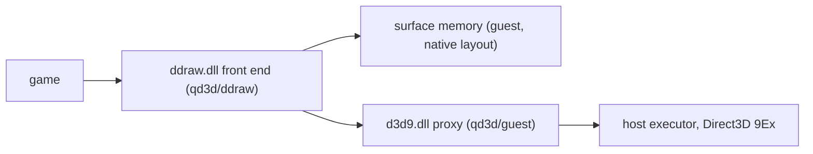

# DirectDraw and Direct3D 1-7 over QD3D

Status: active design, 2026-11-02. Replaces, for applications, XP's stock
`ddraw.dll` running DirectDraw and Direct3D 1-7 through the XPDM display
driver's DirectDraw/D3D DDI (`guest/xpdm/qxpdisp/directdraw.c`), the slow
path. Direct3D 8/9 remoting is `docs/design/d3d9-remoting.md`.

## Architecture

`qd3d/ddraw/` builds a replacement `ddraw.dll` (i686 MinGW C++, no
exceptions, RTTI or libstdc++ runtime; XP SP3 imports only,
`make check-imports`). It implements DirectDraw itself and runs everything
that needs the GPU on one Direct3D 9 device per DirectDraw object, created
on the QD3D proxy `d3d9.dll`, so the host executes it on Direct3D 9Ex.

| Path | Role |
|---|---|
| `qd3d/ddraw/qdd.h` | Contract between the DirectDraw core and the Direct3D code. |
| `qd3d/ddraw/qdd_priv.h` | Core internals. |
| `qdd_main.cpp` | Exports, runtime selection and fallback, logging, lock, interface registry, class factory. |
| `qdd_draw.cpp` | `IDirectDraw`/2/4/7, cooperative levels, display modes, caps, emulated vertical blank. |
| `qdd_surface.cpp` | `IDirectDrawSurface`/2/3/4/7, `IDirectDrawGammaControl`, creation of complex surfaces, attachments, Lock, GetDC, Flip, color keys, private data. |
| `qdd_blt.cpp` | Blt, BltFast, fills. |
| `qdd_gpu.cpp` | The Direct3D 9 device, surface copies and transfers, presentation, presenter thread. |
| `qdd_format.cpp`, `qdd_mem.cpp` | Pixel formats and conversions; section-backed surface memory. |
| `qdd_palette.cpp`, `qdd_clipper.cpp` | `IDirectDrawPalette`, `IDirectDrawClipper`. |
| `qdd_d3d7*.cpp` | Direct3D 7 (and later 1-6) on the shared device (section Direct3D 7). |
| `test/qdd_smoke.cpp`, `test/qdd_d3d7_smoke.cpp` | Smoke tests with exact pixel checks. |

All 22 exports of XP SP3's `ddraw.dll` exist with its ordinals.
`DirectDrawCreate`/`Ex`/`Clipper`, `DirectDrawEnumerate*`,
`DllGetClassObject` (`CLSID_DirectDraw`, `CLSID_DirectDraw7`,
`CLSID_DirectDrawClipper`), `DllCanUnloadNow`, `Acquire`/`ReleaseDDThreadLock`
and `GetSurfaceFromDC` are implemented; the internal ones other system DLLs
call (`DSoundHelp`, `D3DParseUnknownCommand`, `DDInternalLock`, ...) go to
the stock runtime with the argument sizes of the XP SP3 exports.

## Runtime selection and fallback

Every DirectDraw creation asks `d3d9.dll` for an `IDirect3D9`: a QD3D
`d3d9.dll` the process already has (a game's own copy; a second proxy would
claim a second channel slot), else the one in the front end's own directory
(installed: the QD3D proxy in System32; in a test directory, the proxy beside
it), else the system copy. `qd3d/tests` `make run-one-proxy` checks the first
rule for both front ends.
Only when that object answers `IID_QD3D_REMOTE` does the front end take the
call. Otherwise the call, and every later export, goes to the stock
runtime: `System32\qddraw_orig.dll` when present (the system-wide installer
keeps the stock DLL under that name), else `System32\ddraw.dll` (the front
end is a per-game copy). A DLL carrying the `QD3D_MARKER` resource, or the
front end itself, is never taken as the stock runtime.
`QDDRAW_TEST_SYSTEM_DIR` stands for System32 in tests. Rare events go to
`%TEMP%\qd3d.log` in the proxy's line format
(`YYYY-MM-DD hh:mm:ss pid exe: message`): the first front end use per
process, or the fallback and why; the first Direct3D 9 device and Reset
failures. `QDDRAW_LOG=<file>` also writes the debug lines (`qddraw: loaded
<d3d9 path>`).

## Object model

Every COM object is a plain struct with one facet per interface version
(a class deriving from that interface). Interface pointers passed in are
mapped back through a registry, never by calling them. Counts follow the
native runtime (Wine's ddraw tests, the stock runtime as oracle):

- `IDirectDraw`, 2, 4 and 7 have separate counts; `IUnknown` is the
  `IDirectDraw` interface. The object lives while any count is non-zero.
  `IID_IDirect3D7` is answered only by objects from `DirectDrawCreateEx`
  (or `CLSID_DirectDraw7`), `IID_IDirect3D`/2/3 only by the others.
- Surfaces count per interface (`IDirectDrawSurface`/2/3/4/7; `IUnknown`
  shares `IDirectDrawSurface`'s; the gamma control has its own). Every
  surface of a complex structure (flip chain, mip chain, cube map) starts
  with one reference of its creator's version; the structure dies with its
  root. Surfaces, palettes and clippers made through `IDirectDraw4`/7 hold a
  reference on that interface. `GetDDInterface` returns the creating
  interface.
- Complex attachments use Wine's layout: front → back 1 → ... → back N →
  front; mip level → next level; cube root (+X) → −Z, +Z, −Y, +Y, −X, then
  +X level 1. `AddAttachedSurface` holds a reference on the interface
  passed in; z-buffers attach to same-size render targets.
- Surfaces of `IDirectDraw`/2/4 objects answer unknown IIDs with
  `E_INVALIDARG` once a Direct3D interface was handed out, before that
  (and for `IDirectDraw7` surfaces) `E_NOINTERFACE`, as native does.

## Surface memory and locations

Every surface has a system-memory copy in the native layout: pitch is the
row size rounded up to 8 bytes (measured on the stock 32-bit runtime), DXTn
surfaces report their total `dwLinearSize`. `Lock` returns it. Surfaces of
GDI formats (P1/P4/P8, 16/24/32-bit RGB) of 64 KiB or more are allocated by
`CreateDIBSection` (no section handle, as wide as the pitch), so `GetDC`
selects the surface's own DIB and GDI draws into it without a copy; the
primary's GDI presentation blits from it too. Smaller surfaces (sprites)
live on the heap, since a DIB section costs a 64 KiB address-space
reservation each, and `GetDC` works on a surface-sized DIB copied back at
`ReleaseDC`; so does application memory (`DDSD_LPSURFACE`).

A surface gets a Direct3D 9 copy only when needed: a render target for
`DDSCAPS_3DDEVICE` surfaces (level 0 of a `D3DUSAGE_RENDERTARGET` texture
when the surface is also a texture), a depth stencil for z-buffers, the
presentation copy of the primary. Each buffer records which copies are
current. CPU work (Lock, Blt on the CPU, GetDC) runs on the system copy,
reading the Direct3D 9 copy back first when only it is current; GPU work
uploads the system copy first when the CPU changed it. Work on surfaces
that only exist on the GPU stays there: a plain copy or stretch from such a
surface runs as `StretchRect`, a color fill as `ColorFill`, a depth fill as
`Clear` (depth stencil and viewport restored). Flip rotates the buffers of
a chain: surface objects keep their identity, contents move. Textures are
the Direct3D code's: it reads the current system copy and keeps its own
Direct3D 9 textures, re-uploading when the surface's version changes.
`DuplicateSurface` makes a second surface object on the same buffer (both
copies shared); the source stays alive until the duplicate goes, and
primaries and complex structures answer `DDERR_CANTDUPLICATE`.

The front end draws some transfers itself (`qdd_pass.cpp`, ps_2_0 token
streams, no compiler at run time; every pass saves and restores the device
state it touches and runs outside the Direct3D 7 device's scene):

- **Depth.** A z-buffer's Direct3D 9 copy is `D32F_LOCKABLE`
  (`D16_LOCKABLE` where offered; the RTX 4090 offers only the former)
  without stencil, level 0 of an `INTZ` texture with stencil. Reads lock the
  lockable copy or resolve the INTZ depth through a pixel shader into an
  R32F target; writes always draw the depth with `oDepth` from an R32F
  texture, because CPU writes into a lockable depth buffer are ignored by
  the depth test (Measured on the host with a bare Direct3D 9 program:
  LockRect zeros, then a z=0.5 `LESSEQUAL` quad still passes there). Values
  convert between the surface's depth mask (any of the D16, D24 low/high,
  D32 layouts) and [0, 1]; conversions are safe under the 24-bit x87
  precision Direct3D sets. Stencil formats move their stencil bit by bit:
  stencil-tested draws REPLACE the bits a shader keeps (upload) or add a
  constant per bit into a color target (readback). Lock data follows the
  surface's advertised masks (the stock runtime returns the driver's own
  D24S8 layout whatever the descriptor says; Measured).
- **P8.** The copy of an 8-bit palettized surface is drawn from its indices
  (L8 texture, a quarter of the 32-bit frame) through a 256x1 palette
  texture: a palette change uploads 1 KiB, a frame only its indices.
  A P8 copy that was rendered to (legacy software devices) reads back to the
  nearest palette entries, cached per 15-bit color and palette version.
- **Gamma.** `SetGammaRamp` applies to every QD3D frame in the presentation
  pass (the frame through a 256x1 lookup texture), not to the surfaces.

## Formats

P8 (and P1/P2/P4 in system memory), R3G3B2, A8R3G3B2, X4R4G4B4, A4R4G4B4,
R5G6B5, X1R5G5B5, A1R5G5B5, R8G8B8, X8R8G8B8, A8R8G8B8, X8B8G8R8, A8B8G8R8,
A8, L8, A8L8, A4L4, V8U8, L6V5U5, X8L8V8U8, depth D16, D15S1, 24-bit
descriptors, D24X8, D24S8 and D24X4S4 with the depth in the low or the high
24 bits (each layout keeps its masks), D32, FOURCC DXT1-5, YUY2/UYVY and
YV12 (YUV formats in system memory only as textures, as the stock
runtime; `GetFourCCCodes` lists DXT1-5, YUY2, UYVY, YV12). YV12 is planar:
the Y plane at the reported pitch, then V and U at half the pitch and
height. Render-target copies use the surface's Direct3D 9 format when the
host renders to it, else X8R8G8B8/A8R8G8B8 with conversion on upload and
readback (24-bit, BGR, P8). Blits between formats that differ only in an
alpha-or-unused channel copy the bits (stock: X1R5G5B5 -> A1R5G5B5 keeps
the top bit). Blits with a DXT format on either side that are not
unscaled block-aligned copies of one format decode the source and the
touched destination blocks to A8R8G8B8 and encode the result (endpoints:
the two most distant colors, the larger 5:6:5 value first, the nearest of
the four colors per pixel; three-color mode for DXT1 blocks with
transparency). YV12 sources convert (BT.601 studio range) for blits to RGB
surfaces, stretched or not; YV12 to YV12 moves the planes unscaled; YV12
surfaces take no fills or raster operations.

## 2D operations

Blt (color and depth fill, copy, stretch, source and destination color
keys including overrides, `DDBLTFX` mirroring, `SRCCOPY`/`BLACKNESS`/
`WHITENESS` (every bit, also outside a z-buffer's depth mask; not on
FOURCC surfaces), clipping by the destination's clipper: window region or
clip list), BltFast, Flip (chains, target override, `DDFLIP_INTERVAL2-4`,
`NOVSYNC`), GetDC/ReleaseDC, palettes, color keys, gamma ramps follow the
native results the Wine tests record. Stretching samples
`src.left + floor((x - dst.left) * src_w / dst_w)` from the original image,
self-overlap included. A destination-key blit through
`IDirectDrawSurface4/7` uses the destination's key, through the older
interfaces the source's destination key, which a cleared key keeps
(measured; GetSurfaceDesc reports cleared keys as zero). YUY2/UYVY color
fills write the value as a macropixel. Alpha and z blit flags are
accepted and ignored, as native. `BltBatch` answers `DDERR_UNSUPPORTED`
(not implemented by the Windows runtime either, per its documentation).
Overlays are absent consistently: no overlay caps, `DDSCAPS_OVERLAY`
creation fails with `DDERR_NOOVERLAYHW`, overlay methods on other surfaces
answer `DDERR_NOTAOVERLAYSURFACE`, `IDirectDrawColorControl` is not
offered.

Objects created with `DDCREATE_EMULATIONONLY` report empty driver caps and
put every surface in system memory (16/32-bit z-buffers only);
`DDCREATE_HARDWAREONLY` objects report empty emulation caps (as stock).

Display modes: `EnumDisplayModes` offers 32, 24, 16 and 8 bits per pixel at
every resolution the guest's GDI has at 32 bits. `SetDisplayMode` changes
the guest desktop to that resolution at 32 bits (input coordinates match)
and emulates the depth: the primary has the requested format, presentation
converts. `QDDRAW_VIRTUAL_MODES=1` never touches the real display (host
tests; `run-loopback.ps1 -WithDDraw` sets it). Exclusive mode moves the
cooperative window over the screen and clips the cursor to the mode. The
vertical blank is emulated from the mode's refresh rate
(`WaitForVerticalBlank`, `GetScanLine`, `GetVerticalBlankStatus`, Flip
pacing). `GetDeviceIdentifier` reports the host adapter.

## Presentation rules

The VM shows QD3D frames as the whole screen, so:

- A process without a Direct3D device whose DirectDraw object is not in
  exclusive mode presents through GDI: writes to the primary go to the
  screen (a blit through a clipper only inside its region), reads of the
  primary come from the screen. It produces no QD3D frames; the guest
  desktop shows the window.
- Exclusive mode, or any Direct3D device in the process: the primary
  presents through QD3D on the object's device. Flip presents the new front
  buffer at once. A write to the primary that covers the whole frame (a
  windowed 3D game's Blt of its back buffer) presents at once unless a
  frame already went out in this emulated refresh period; smaller writes,
  palette changes, gamma changes and GDI drawing on the primary mark it
  dirty, and a presenter thread presents it at the next emulated vertical
  blank, skipping periods that already presented. So a game that changes
  its palette or draws text on the primary many times per frame costs at
  most one extra present per refresh (Age of Empires II's menus presented
  per SetEntries before: 3 fps in the VM). The frame is the whole primary in
  exclusive mode, the cooperative (or clipper) window's client area of it
  when windowed. The device's back buffer follows the frame size (Reset,
  bracketed for the Direct3D code).
- Leaving exclusive mode with no Direct3D device in the process releases
  the Direct3D 9 device, so the host hands the display back at once.

## Tracing

`QDDRAW_TRACE=1` with `QDDRAW_LOG=<file>` writes statistics to the log once
per second: every DirectDraw method called in that second (calls, total and
longest time, presents caused inside it), transfers (upload, readback,
depth, count, KiB, time), presents by the presenter thread, vertical blank
waits (application, presenter), and waits for the front end's lock (count,
total, longest); the first three failures of each method are logged as
they happen. Methods are timed by pointing every vtable slot at a generated
thunk (`qdd_trace.cpp`); with tracing off nothing is patched.

## Direct3D 7

`IDirect3D7`, `IDirect3DDevice7` and `IDirect3DVertexBuffer7` run on the
DirectDraw object's shared Direct3D 9 device (`qdd_d3d7*.cpp`, contract in
`qdd.h`). Each device keeps a full shadow of its state and re-applies it
when another device draws; state blocks are emulated; Direct3D 9 scenes
open lazily and close before Present and Reset; vertex declarations replace
FVFs. Textures are managed Direct3D 9 copies converted from the surface
bits and re-uploaded per level when the surface changes; a color key
becomes alpha 0 in a second keyed copy; P8/P4 go through the palette.
ProcessVertices and ComputeSphereVisibility run on the CPU. Render-state,
texture-stage and transform validity tables, defaults and Clear rules come
from the stock runtime (measured).

## Direct3D 1-6

`IDirect3D3`, `IDirect3D2` and `IDirect3D` exist on `DirectDrawCreate` objects
only, as on stock (`IDirect3D7` only on `DirectDrawCreateEx` objects). The
other interfaces are thin per-version wrappers over the Direct3D 7 objects
(`qdd_d3d7_legacy.cpp`, `qdd_d3d7_viewport.cpp`, `qdd_d3d7_exec.cpp`):
`IDirect3DDevice3/2/1`, `IDirect3DViewport3/2/1`, `IDirect3DLight`,
`IDirect3DMaterial3/2/1`, `IDirect3DTexture2/1`, the DirectX 6
`IDirect3DVertexBuffer` and `IDirect3DExecuteBuffer`.

- **Devices.** One device object answers every interface version it was
  created for. `IDirect3DDevice` is aggregated into the surface it was
  queried from, one device per device GUID. A surface QueryInterface for a
  device GUID returns the device-creation error as is.
- **Enumeration.** EnumDevices lists stock's devices with stock's
  descriptions (measured): version 3 RGB, HAL; version 2 Ramp, RGB, HAL,
  MMX; version 1 Ramp, RGB, HAL. The software devices render through the
  same Direct3D 9 device as the HAL.
- **Texture formats.** EnumTextureFormats lists what stock lists for each
  version: Direct3D 3 leaves out alpha-only and luminance bump formats, and
  Direct3D 2 and 1 list only the plain RGB formats.
- **Legacy state.** Each device keeps the legacy render and light states
  beside its Direct3D 7 state and maps them when it draws: TEXTUREHANDLE
  binds stage 0; TEXTUREMAPBLEND sets stage-0 overrides until an
  application stage state or a new TEXTUREMAPBLEND value replaces them;
  WRAPU/V and the fog and material light states map to their Direct3D 7
  counterparts.
- **Handles.** Material, texture and matrix handles come from one process
  table. Material handles are per device.
- **Viewports and lights.** Viewports transform through the legacy
  projection and the viewport's clip volume. A D3DVIEWPORT's scale defines
  that volume. Lights take viewport slots 1-32, the oldest evicted first.
- **Lighting.** Lit vertices are lit on the CPU with the DirectX 3-6 model:
  always a local viewer, normals through the world-view matrix itself,
  attenuation a0 + a1·x + a2·x² with x = (range − d) / range, no specular
  at material power 0, specular alpha 0, no light limit.
- **Execute buffers** run on the CPU: PROCESSVERTICES transforms (and
  lights) into clip space, clips against the near plane and draws the
  result as pre-transformed vertices; MATRIXLOAD/MATRIXMULTIPLY,
  STATETRANSFORM/STATELIGHT/STATERENDER, TEXTURELOAD, BRANCHFORWARD,
  SETSTATUS and EXIT are interpreted.

Per-version defaults and the following behaviours follow the stock runtime,
measured with Wine's ddraw1/2/4 and d3d tests and qdd_d3d7_legacy_smoke on
the Windows 11 host: viewport record conversion and size checks; the
reference a current viewport holds (dropped on Device3, leaked on Device2
and older); GetHandle rules; GetTexture hiding a TEXTUREHANDLE binding;
device QueryInterface answers; wrong-caps textures bound but not sampled on
hardware devices.

The software devices (RGB, Ramp, MMX) also render into a P8
`DDSCAPS_3DDEVICE` surface that has a palette, through its X8R8G8B8 copy:
clears and draws land on the nearest palette entries when read back (red
0xe0, blue 0x03, gray 0x92 under a 3-3-2 palette); the HAL device refuses
such targets, as on stock. Stock Windows 11 writes palette-independent
indices there (black 0xff, white 0x28 under any palette), so its pixels
are no oracle.

## Tests

- `make -C qd3d/ddraw` builds `build/ddraw.dll` and the tests (`BUILD=<dir>`
  builds elsewhere, `D3D7=0` without the Direct3D code);
  `make check-imports` checks the XP SP3 imports.
- `qdd_smoke` (11 windowed scenes with exact pixel checks: COM identity and
  counts, Lock pitch and layout per format, palettes through GetDC, source
  and destination color keys, stretch, mirror, fills, GetDC drawing,
  windowed presentation through a clipper, overlapping blits; a VM-only
  `--fullscreen` scene with P8 and 16-bit flip chains): `make run-stock`
  (stock runtime), `qd3d/tests/run-loopback.ps1 -Program <qdd_smoke.exe>
  -WithDDraw -Arguments --expect-local` (front end on the loopback
  executor), `make run-fallback` (front end without a QD3D session hands
  everything to the stock runtime and logs why).
- `qdd_d3d7_smoke` (Direct3D 7 scenes) and `qdd_d3d7_legacy_smoke` (21
  Direct3D 1-6 scenes with exact pixel checks: Direct3D 3 interfaces,
  enumeration, Clear2, pre-transformed and transformed quads, lights,
  TEXTUREMAPBLEND, texture handles, vertex buffers, Begin/End, fog, colour
  keys, defaults; Direct3D 2 enumeration, the three vertex types, texture
  handles; Direct3D 1 execute buffers), the same three runs.
- `qdd_bench` measures frame rates of a 2D menu-style frame (background and
  keyed sprite Blts, GDI text through GetDC, a Lock/Unlock cursor, optional
  SetEntries and GDI on the primary, `--gamma`, Flip or a windowed Blt);
  `--exclusive` (800x600x8 flip chain) runs only on the front end with
  `QDDRAW_VIRTUAL_MODES=1`.
- Wine's ddraw tests (`qd3d/conformance`, `run.ps1 -Tests ddraw_* -Modes
  stock,qd3d -DDrawDll <dll>`); exclusive-mode and display-mode tests run in
  the VM only.

## Measured results

Measured 2026-11-02 on the RTX 4090 Windows 11 host, loopback executor
(`run-loopback.ps1 -WithDDraw`), integrated build:

| Test | Stock `ddraw.dll` | Front end, QD3D |
|---|---|---|
| `qdd_smoke` (11 scenes) | 10/11, `colorkey_dest` skipped (stock reports no destination keys) | 11/11 |
| `qdd_smoke --expect-fallback` (no QD3D session) | — | 10/11 on the stock runtime, logged `no QD3D session (...) -> stock runtime` |
| `qdd_d3d7_smoke` | (its own report) | 21/21, 1 skipped, 282 ms |
| `qdd_d3d7_legacy_smoke` (D3D7Device's run, 14:58 build) | 21/21 | 21/21 |

Wine ddraw tests, stock and QD3D in one run (`%TEMP%\qdd-r3-a`, all nine
programs; ddraw4/7 rerun after the last fix in `%TEMP%\qdd-r3-c`): checks
executed, failures, and lines failing only through QD3D (`%TEMP%\qdd-r2-before`
is the same comparison at the start of round 2):

| Test | Stock checks / failures | QD3D checks / failures | QD3D-only lines, round 2 start → now |
|---|---|---|---|
| refcount | 65 / 0 | 65 / 0 | 0 → 0 |
| dsurface | 1166 / 0 | 1166 / 0 | 1 → 0 |
| d3d | 2496 / 0 | 2496 / 0 | 0 → 0 |
| ddrawmodes | 604 / 0 | 636 / 0 | 0 → 0 |
| visual | 0 / 0 | 0 / 0 | 0 → 0 |
| ddraw1 | 19856 / 17 | 19911 / 9 | 5 → 1 |
| ddraw2 | 22376 / 0 | 22446 / 10 | 6 → 2 |
| ddraw4 | 25109 / 1 | 25213 / 11 | 11 → 2 |
| ddraw7 | 31383 / 1 | 31459 / 11 | 19 → 2 |

The lines left are the GetDC gaps below (`test_getdc` image size,
`test_user_memory_getdc` bits). QD3D runs a few more checks than stock
because its YV12 and DXT paths let tests run that skip on the stock
runtime (YV12 to system-memory RGB blits fail there). ddraw4 and ddraw7
crash in `test_map_synchronisation` in both modes (a timing-sized vertex
buffer).

Frame rates (`qdd_bench`, 3 s runs):

| Run | Stock | Front end before (14:03 build) | Front end now |
|---|---|---|---|
| windowed, desktop format, GDI path | 243.3 fps | — | 1582.4 fps |
| windowed with a Direct3D 7 device (QD3D path) | — | — | 1344.1 fps |
| exclusive 800x600x8, Flip(WAIT) | — | 60 fps | 60.4 fps |
| same, 16 SetEntries per frame | — | 8.6 fps (palette phase 108 ms/frame) | 60.4 fps (0.00 ms) |
| same, + GDI on the primary | — | 8.2 fps | 59.6 fps |

From the trace of the last run: a Flip's present costs 0.65 ms (5.2 ms with
the CPU P8 conversion), uploads 49-66 ms/s for 60 frames (284 ms/s),
lock waits 27-46 ms/s (196 ms/s). In the VM, Age of Empires II's menus ran
at 3.1-3.5 fps with the 14:03 build (host log); the current build is
untested there (Unknown).

## Known gaps

- Direct3D 1-6:
  - Ramp and MMX devices render like RGB devices, with no mono ramp shading.
  - `Pick` finds nothing (`GetPickRecords` returns 0 records).
  - Viewport background depth surfaces are accepted but not drawn by Clear.
- The device descriptions lack stock's antialiasing raster caps
  (ANTIALIASSORTINDEPENDENT, ANTIALIASEDGES); QD3D's Direct3D 9 device
  reports none.
- `GetDC`: the DC bitmap reports a non-zero `biSizeImage` (native 0), and for
  `DDSD_LPSURFACE` surfaces its bits are a copy, not the application's
  memory (no user-mode API puts a DIB section on arbitrary memory).
- Blits with color keys onto surfaces the GPU wrote run on the CPU after a
  readback (correct, slower).
- `EvaluateMode`/`StartModeTest` return the documented errors.
